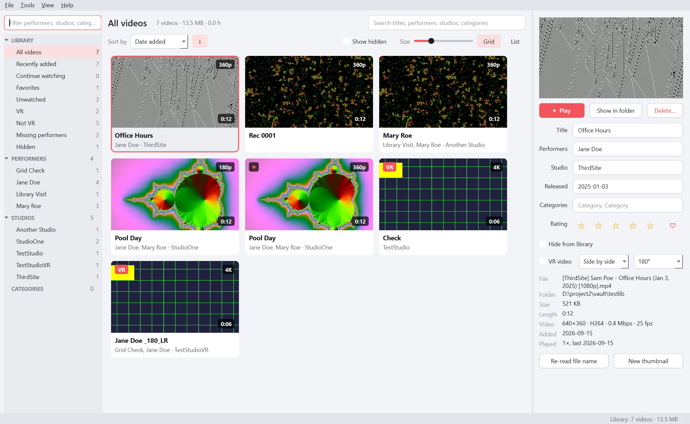
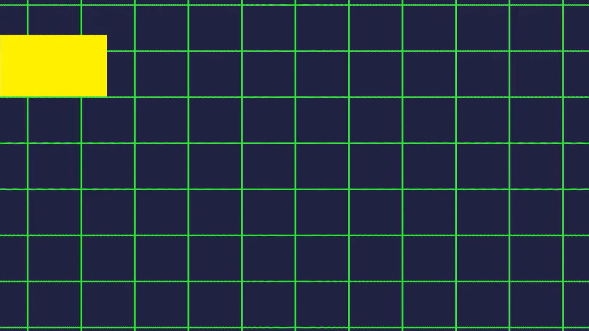
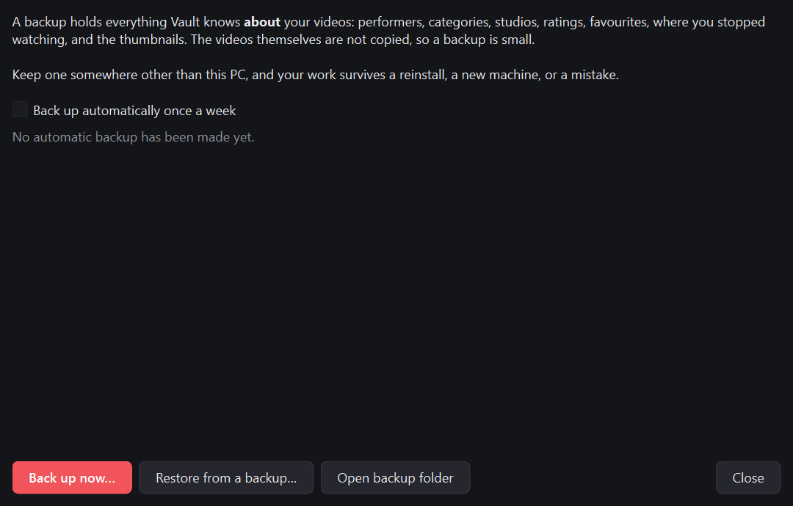

# BlueShelf

A library and player for a large adult video collection on Windows. It reads the file and folder
names you already have, works out performers, studios, dates and categories, makes thumbnails, plays
everything including VR, finds duplicates, and helps you clear out what you no longer want.

Everything stays on your PC. No account, no internet connection, no telemetry.



## What it does

- **Sorts itself out.** Point it at a folder — a local drive or a network share — and it reads the
  names to fill in performers, studios, release dates and categories. It recognises the common
  release formats, and uses `organized/<name>/` style folders when you have them.
- **Plays anything**, using mpv: hardware decoding, resume where you stopped, favourites, ratings,
  play counts, MPC-style keyboard shortcuts.
- **VR done properly.** 180°, 360° and fisheye videos are detected and shown as a normal flat
  picture — drag to look around, scroll to zoom, swap eyes. No more squinting at two warped halves.
- **Finds duplicates**, both identical copies and the same scene re-encoded at another resolution,
  and pre-selects the lower-quality copy for deletion.
- **Tidies up names.** Suggests merging spellings of the same performer ("Lily Labele" into "Lily
  LaBeau") and spots titles that were mistaken for performers.
- **Deletes safely.** Deleted videos go to a hidden trash folder on the same drive, restorable until
  you empty it.
- **Cleanup mode** for cutting a collection down: watch, then one key to keep or delete, and it moves
  straight to the next.
- **Watch on a Quest or a phone.** BlueShelf can serve your library to your own network, so a headset
  browser can browse by performer, watch, and delete — which no VR video player can do.



## Requirements

- Windows 10 or 11, 64-bit
- About 400 MB of disk space for the app
- A reasonably modern graphics card for smooth 4K and 8K VR playback

## Installing

1. Download `BlueShelfSetup-x.y.z.exe` from the releases page.
2. **Windows will warn you.** The installer is not code-signed, so SmartScreen shows "Windows
   protected your PC". Click **More info**, then **Run anyway**. If you would rather check first,
   compare the SHA-256 in the release notes with:
   `Get-FileHash BlueShelfSetup-x.y.z.exe -Algorithm SHA256`
3. It installs for your user only and does not ask for administrator rights.

Antivirus software sometimes flags apps built this way. Nothing here phones home; the source is
published with every release if you want to look or build it yourself.

## First run

1. **Add a video folder.** Local or a network drive, for example `Y:\` or `\\nas\videos`.
2. Wait for the first scan. Reading details and making thumbnails for a few hundred videos over a
   network takes a while; it only happens once.
3. **Tools → Review names** to merge performer spellings it was not sure about.
4. Anything you edit by hand is never overwritten by a later scan.

## Watching on a Quest or a phone

**Tools → Share with a headset, phone or TV**, tick it on, and open the address shown in the headset
browser — it ends in a word you can change to anything easy to type, like `192.168.1.169:8760/blueshelf`.
You get your library by performer, playback, and a delete button for the video you are watching.

Tap **VR** and a 180°, 360° or fisheye video wraps around you, one eye to each display. Pull the
trigger for a panel you can point at: play, skip, jump 30 seconds, favourite, seek and delete. That
last one is the reason this exists — no VR video player will let you throw a scene out while you
are watching it.

Two things to expect the first time:

- **A warning that the page is not private.** Choose *Advanced* → *Continue*. Browsers only offer
  VR on a secure page, and no certificate authority will vouch for a bare address on your own
  network, so BlueShelf signs its own. The warning appears once per device.
- **Windows Firewall.** Click **Allow through Windows Firewall** in that window — without it, other
  devices cannot reach your PC at all. BlueShelf only listens on your own network and needs the
  passcode that is part of the address.

### DeoVR, Skybox, TVs and consoles (DLNA)

The same window has a DLNA switch. Turn it on and BlueShelf appears in the media-server list of
DeoVR, Skybox, HereSphere, most smart TVs, consoles, VLC and Kodi, laid out like the sidebar:
performers, studios, categories, VR, favourites. VR scenes open in the right projection by
themselves — BlueShelf adds the tags both DeoVR and Skybox look for to each title.

Click **Allow through Windows Firewall** under it the first time; DLNA needs its own two rules.
DLNA has no passcode, so anything on your network can browse and play what is shared. Hidden
videos are never shared, and nothing outside your own network can reach it.

## Passthrough copies

A passthrough video is an ordinary VR scene with a cut-out of the performer packed into the corners
of each frame. DeoVR reads those corners as a mask, so the performer appears in your actual room
instead of against a filmed background. Studios that sell them shoot against a green screen.
**Tools → Make passthrough copies** makes them from a scene that never had it, by asking a matting
model which pixels are the person.

The cutting out is done by [VRAutoMatte](https://github.com/SifuInTheShell/VRAutoMatte), which BlueShelf runs for you. It is a
separate download on purpose: it carries PyTorch and a CUDA build with it, several gigabytes, and it
needs an NVIDIA graphics card. Bundling that into BlueShelf would multiply the size of the installer
for a feature most people could not run.

BlueShelf does not install it for you. Three steps, on each machine that will do the work:

1. Download it — `git clone https://github.com/SifuInTheShell/VRAutoMatte.git`, or the zip if you
   would rather not install git.
2. Install [uv](https://docs.astral.sh/uv/) — `winget install astral-sh.uv`. Open a fresh terminal
   afterwards, or `uv` will not be on the path yet.
3. Run **`uv sync`** in that folder. This is the several-gigabyte part; it downloads PyTorch.

   Not its `run.bat`. That asks for every optional extra, and one of them (MatAnyone2) has a
   packaging fault upstream that stops the whole install. `uv sync` gets you the two models
   BlueShelf actually offers, which are the faster ones anyway.

Then point BlueShelf at the folder — it finds it on its own if it sits beside BlueShelf or one
folder up. BlueShelf itself never calls `uv`: it runs the interpreter inside that environment
directly, so once it is built, uv is only needed again to update it.

Press **Check it** and BlueShelf reports the card it will use. Then add videos - **Add from library…** browses by performer, studio, category, folder or any of the sidebar's views, and **Browse for files…** picks them off disk - and start. They are done one after another, and one that fails does not stop the rest. Expect
roughly real time per eye on a laptop card: an hour-long 8K scene is most of a night. The copy is
saved beside the original as `<name>_FISHEYE<angle>_alpha.mp4`, added to your library and marked
**Passthrough**, so it shows up in the DeoVR feed as one.

### Skipping the talking

Most scenes open with several minutes of clothed conversation. Matting that is wasted time —
there is nothing anyone wants floating in their room. Tick **Only matte the parts with action**
and press **Scan this video**.

The scan reads the video through cheaply, decoding one frame every few seconds rather than all of
them. It draws the result as a strip, picks out the stretches that look like action, and mattes
only those. The rest becomes a blank mask, which costs nothing to make: the scene plays as an
ordinary VR video through the talking, and your room appears when the action starts. Nothing is
cut — the copy is the same length as the original.

**Judge** chooses how it decides:

- **By what is exposed** — the one to use. A detector names the parts of a body on screen and says
  whether they are covered, which is close to the real question. It needs one extra install; see
  below.
- **By how much skin is on screen** — the fallback, and a poor guide in VR. A POV scene keeps the
  performer close to the lens throughout, so the conversation measures about as high as the rest.
  On a real file it called the last four minutes quiet when they were not.

The detector is not part of BlueShelf. To fit it, run this in the VRAutoMatte folder:

```
uv pip install --no-deps nudenet opencv-python-headless
```

It is [NudeNet](https://pypi.org/project/nudenet/), MIT licensed, and the model comes with the
package — nothing is downloaded at scan time and nothing leaves your machine. `--no-deps` matters:
it pulls plain `onnxruntime`, which would fight the DirectML build VRAutoMatte already has. Without
it, BlueShelf falls back to the skin measure and says so.

**A machine that only helps** can skip the library entirely: **Tools → Help another computer**
opens straight onto the helping tab, and starting BlueShelf with `--helper` does the same from
the shortcut. A helper needs no library, no scanning and nothing picked — only VRAutoMatte and
the shared folder.

**View → Passthrough window** (Ctrl+P) brings the passthrough window back, and the passthrough
window's own **View → Library window** (Ctrl+L) puts the library away while a long job runs.

**The window stays out of the way.** It opens beside the library rather than on top of it, so you
can carry on browsing and watching while it is there — useful for checking what is actually in a
scene before deciding where the action starts. Videos can be **dragged straight in**, from the
library behind or from a folder window. Closing it puts it away without throwing anything out: the
list, the scans and any job under way all survive until BlueShelf itself is closed, and a matte
that is running keeps running with the window shut.

**Scans are kept.** Reading a video takes a minute or two, so the result is stored against the
file, along with anything you marked by hand — close the window, restart BlueShelf, come back a
week later, and it is still there. Change the file, though, and it is scanned afresh: a re-encode
makes the old timings meaningless, and matting against somebody else's would be worse than not
remembering. **Forget this scan** throws it away deliberately.

**Treat the result as a guess and check it**, whichever measure you use. BlueShelf works out where
to draw the line from each video's own spread rather than using a fixed number, which is better
than a constant and still only a guess.

So the strip is editable. Drag across any part of it and press **Mark dragged as action** or **Mark
dragged as talk**. The sensitivity slider moves the line, **Pad** widens every stretch at both ends
so nothing is clipped, and **Ignore under** drops stretches too short to be real. **Back to the
scan** undoes your edits.

Two things follow from how the matting model works:

- Each stretch restarts the model cold, so each one mattes a couple of seconds before it really
  begins and throws that part away — the same run-up a share needs when work is split across
  machines.
- Short gaps between stretches are bridged rather than honoured, because every restart costs that
  run-up and risks the cut-out blinking off for a moment.

The saving is exactly the fraction you skip. Ten minutes of intro in a forty-minute scene is a
quarter off, which is worth having and is not a transformation.

### How sharp the cut-out is

**Detail** decides how much of each frame the matting model is shown. It matters more than
anything else here.

VRAutoMatte sizes this from the graphics card's memory, and its table is far too cautious: an
8 GB card is dropped to nearly its coarsest setting, which shows the model about 960×960 of a
3584×3584 eye and then scales the matte back up almost fourfold. Measured on a real scene, that
produced soft haloed edges and green showing straight through the performer's body. The same card
ran the setting meant for 15 GB without complaint, and only **17% slower**, with crisp edges and a
solid cut-out.

So BlueShelf chooses instead, and defaults to **fine**. Drop to *coarse* or *normal* on a card with
little memory; try *finest* on a roomy one. Because most of a job's time goes on reading the video
and re-encoding rather than matting, the difference to the total is smaller than the numbers
suggest — nearer a tenth than a sixth.

### Working in chunks

**Work in chunks of** cuts the matting into runs of a few thousand frames, matted one after
another and joined at the end. The default is 5000 — about a minute and a half of 60fps footage.

It matters because these jobs are long. Matting a forty-minute scene in one pass means anything
that goes wrong near the end throws away the lot, and something does go wrong. In chunks, a
failure costs the chunk it was on: the finished ones stay on disk beside the video in a hidden
`.<name>.work` folder, and starting the same job again picks up from there rather than beginning
over. Stopping deliberately works the same way.

**Starting the same video again after a crash** picks up where it stopped. Each chunk already on
disk is recognised and skipped, and the log says so as it goes. The check itself is quick — the
frame count is read from each file's header rather than by decoding it, which is the difference
between a couple of seconds and well over an hour on a long film. A chunk a crash caught mid-write
has no such header, so that one is counted the slow way and redone, which is exactly the file whose
length cannot be trusted.

Set it to zero to do the whole thing in one pass.

**Starting the same video again** picks up where it stopped — and not only at the chunks. The
steps after them take the best part of an hour on a long film: joining the mask, cutting the
picture, converting both to fisheye, and packing the cut-out in. Each one is kept once it is made
and skipped if it is still there and the right length, so a crash near the end costs the step it
was on rather than the whole evening. Half-finished files are thrown away only once there is a
finished copy to show for them. BlueShelf looks at each chunk already
in the `.work` folder, keeps the ones that are complete, and mattes only what is missing — the log
says "Chunk 4 of 37 was already done" as it goes. A chunk a crash caught mid-write has no proper
frame count recorded in it, so it is re-done rather than trusted.

Beside them sits a note of what the job was set to. Starting the same video again with a setting
that would make those chunks useless — a different model, detail or chunk size — asks first and
says exactly what changed, rather than quietly matting everything a second time. Changing the lens
angle or the quality of the copy is free: they affect the copy, not the mattes.

The chunks live in a hidden folder named after the source video, so changing the lens angle or
the quality of the copy does not lose them — only the source and the chunk size decide where they
are looked for.

That check reads each chunk's header rather than decoding it. Counting frames properly means
reading the whole file — about forty seconds for a chunk of 8K on a local disk and minutes over a
network — which on a long film meant over an hour of checking before any work resumed.

### Seeing it part-way through

Half an evening in, you may want to know whether the other half is worth it. **Make one from the
N that are done** builds a playable copy out of the chunks already matted, and nothing else. It
holds only those parts, so it is as long as the work rather than as long as the film, and every
minute of it has the cut-out. The stretches not matted yet are left out rather than filled in —
filling them would mean encoding hours of 8K to hand back the original video.

It costs nothing and changes nothing — no chunk is matted again, none is thrown away, and the real
job carries on from exactly where it was. The copy is saved separately, as
`<name>_sofar_FISHEYE<angle>_alpha.mp4`, so it never overwrites the finished one.

### Spreading one video over several computers

Tick **Spread the work across several computers** and choose a folder every machine can reach — a folder
on the NAS beside the videos is the obvious one. BlueShelf cuts the video into shares, files them
there, and takes one itself.

**Stopping asks what you want.** Pressing Stop offers to finish the chunk being matted first,
or to drop it — with the current position shown, since that is what the choice turns on. A chunk
dropped at its last frame has thrown away ten minutes; one dropped at its first has thrown away
nothing. Everything already finished is kept either way.

**Chunks you have already matted are kept.** If you started a video on one machine, got part
way and decided to bring another in, just tick the box and start it again: the finished chunks in
its working folder are taken over, counted as done, and only the rest is offered around. Nothing
is matted twice. A chunk a crash caught mid-write is not trusted, and goes back in the queue.

On the other machine, open the same window and use the **Help another computer** tab. Point it at
the same folder and press **Start helping**: it takes whatever is waiting, mattes it and puts the
result back. Nothing else needs setting up and no machine is in charge — work is claimed by renaming
a file, which either succeeds or does not, so two computers can never take the same share.

**When a chunk fails**, the reason appears in the box below the shared folder and **Try the
failed chunks again** puts them all back in the queue for any machine to pick up. It happens
automatically too: a video whose remaining chunks have all failed is offered once more before
being given up on, because they usually fail for a reason common to all of them.

**Every chunk lives in one place** — the working folder beside the video — whether one machine
made it or five did. Nothing is copied about when a job is shared out or taken back, and a job
that is given up on leaves its chunks where the next attempt will find them.

**The last stage is shared out too.** Once the mask is joined, projecting it and packing it into
the picture goes back into the same queue as ranges of frames, and any machine takes any of them.
Matting needs a run-up for every piece because the model carries state between frames; this stage
does not, so its pieces cost nothing to make small — which is what balances the machines. One a
third the speed simply finishes a third as many, and the longest anyone waits at the end is one
piece.

The joining at the very end cannot be split — something has to write a single file — but it does
not have to be done by whoever started the job. It goes into the queue like everything else, and
the machine with the best measured link takes it, because joining is all reading and writing and
no computing. If that machine does not appear within ten minutes, anybody may take it rather than
leave the job unfinished.

**Knowing which machine should do what.** Press **Check this machine** on each one — it is on
both tabs, so a helper can be tested without setting anything else up. It times a
real write and read against the shared folder, notes the graphics card, and mattes a few seconds
of video to see how fast it manages — taking that video from the list if there is one, and
otherwise from whatever job is waiting in the shared folder, which also proves the machine can
reach the source by the path the job records — then leaves the answers in `machines\` inside the shared
folder, one small file per machine, where the others read them. No server and nothing to set up;
the same idea as claiming work by renaming a file.

The panel then shows them side by side and says which should start the job. It picks by **link
speed, not graphics card**: matting hardly touches the network, but projecting and packing move
tens of gigabytes, and all of that happens on whichever machine posted the job. A quick card on a
slow line spends that stage waiting.

**Seeing what the other machine is doing.** With the work spread out, the box under the shared
folder lists every machine working from it, which chunk each has, and how long since each last
said anything. A machine touches its share once a minute while it works, so a recent time means it
is genuinely going; one that falls silent for twenty minutes is marked as not responding and its
chunk returns to the queue for somebody else.

Two things worth knowing:

- **Every machine must reach the videos by the same path.** A drive letter mapped differently on
  each one is the usual thing that goes wrong; a network path (`\server\share\…`) always works.
- **Closing it is safe.** A share that was half done goes back in the queue by itself after twenty
  minutes, and another machine picks it up.

A helper needs BlueShelf and VRAutoMatte and nothing else — not the exposure detector, which is
only used for scanning, on the machine you are sitting at.

Each share is matted starting a couple of seconds before it actually begins, and that run-up is
thrown away. The model carries state from frame to frame, so a share started cold in the middle of a
scene gets its first moments wrong. It is the price of splitting a video that was meant to be
watched in one pass, and it is why two computers are a little less than twice as fast as one.

When the last share arrives, the machine that started the job joins the segments and packs the
cut-out into the video. That part needs no graphics card.

## Your data, and backups

Everything BlueShelf knows about your videos — performers, categories, ratings, favourites, resume
points, thumbnails — lives in `%LOCALAPPDATA%\BlueShelf`. Your video files are never modified or moved.

**Tools → Backup** writes all of that to a single small file, and restores it on a new PC or after a
reinstall. It also backs up automatically once a week.



## Handy keys

| Key | Does |
| --- | --- |
| Double-click or Enter | Play |
| Space | Play / pause |
| ← / → | Back / forward, Shift for 1 s, Ctrl for 30 s |
| Alt+← / Alt+→ | Previous / next video |
| F | Full screen |
| V, E, R | VR mode, swap eye, reset view |
| Delete | Delete (asks first) |
| Ctrl+E | Cleanup mode |
| F1 | The full list |

## Known limits

- Names are worked out by pattern, not by looking anything up online, so unusual naming will need
  hand-correcting. Review names helps; edits are kept.
- The headset page has been tested from a desktop browser but not on every headset. Very high
  bitrate 8K video may be more than a headset browser can decode.
- Windows only.

## Licence and source

BlueShelf is released under the licence in `LICENSE`. It includes mpv, FFmpeg, Qt and three.js, each
under its own licence — all LGPL or permissive, none GPL — listed in `THIRD-PARTY-NOTICES.md`. Those
libraries are shipped as replaceable DLLs, as the LGPL requires.
